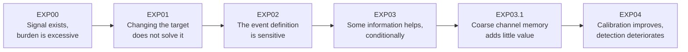

# EXP00–EXP04 — Cross-experiment scientific synthesis

## Executive conclusion

The experiments progressively rule out simple explanations for the current limitations of SAT-Dengue. The system contains predictive signal, but no tested isolated change has preserved onset detection, false-alert burden, temporal stability and territorial consistency at the same time.

EXP04 adds the most important new qualification: **better probability calibration and fewer alerts do not necessarily produce a better warning policy**. Moving calibration windows reduced false-alert burden and improved pooled development Brier scores, but lost between **5.7 and 15.2 percentage points of onset sensitivity** across the six family/horizon combinations. None satisfied the frozen joint criterion, so no calibration window, calibrator, threshold selector or composed policy was selected.

The accumulated evidence therefore points to a narrower scientific problem:

> SAT-Dengue does not primarily lack predictors or retrospective signal. Its unresolved challenge is transporting the complete decision frontier—ranking, calibration, threshold, detection and workload—across years and territories.

This is a negative selection result, not a failed research programme. Each experiment has removed an insufficient explanation and made the remaining problem more precise.

## What each experiment established

| Experiment | Scientific question | Most defensible result | What it rules out |
| --- | --- | --- | --- |
| EXP00 | Do the retained models improve onset detection with acceptable burden? | All six candidate/horizon procedures detect more onsets than persistence, but all violate the frozen false-alert constraint. | More sensitivity alone is not sufficient evidence of operational value. |
| EXP01 | Does direct onset training improve the warning problem? | T+1 onset and excess targets are identical in the admitted cohort; T+2 gains vary by year, family and budget. | Renaming or changing the target is not a general solution. |
| EXP02 | Is the onset label stable when endemic-channel history changes? | H5/H7/H9 alter which months and episodes count as onsets; no history length dominates against a common event definition. | Better self-referenced Brier does not establish a better epidemiological target. |
| EXP03 | Which information blocks contribute predictive value? | Current state helps mainly at T+1; target-month historical thresholds help boosting; climate and other effects are conditional. | Adding more variables or removing the complete channel is not a general solution. |
| EXP03.1 | Does recent channel trajectory add useful memory? | M01 adds only 5 detections with 58 additional false alerts; M02 loses detections and does not improve the reference. | Coarse six-/twelve-month state counts are not the missing general signal. |
| EXP04 | Do moving calibration windows and threshold policies transport detection and burden? | A1–A3 lower burden and improve development Brier, but lose too much sensitivity; no A candidate qualifies, so B/C/D remain unevaluable. | Probability recalibration alone does not repair the operating frontier. |

The absolute metrics above must not be used to rank experiments. Their cohorts, targets, evaluation periods, burden denominators and controls differ. The valid comparison is the progression of scientific questions and the direction of the evidence.

## The main cross-experiment insights

### 1. Signal exists, but signal is not the same as a usable alert policy

EXP00 established that the predictors contain information: every retained candidate improved onset sensitivity over same-horizon persistence. EXP03 later showed that some information blocks can increase detections without always increasing false alerts, particularly current epidemiological state at T+1. The project therefore should not conclude that dengue onset is unpredictable from the available data.

However, every subsequent experiment has shown that the signal is difficult to convert into a stable decision:

- EXP01 found target-dependent gains that disappeared or reversed across years.
- EXP03 found information contributions that changed by horizon, family, year and territory.
- EXP03.1 found only a marginal memory gain at disproportionate alert cost.
- EXP04 reduced alert burden by accepting detection losses larger than the approved non-inferiority margin.

The scientific distinction is now clear: **the models can rank or describe risk to some degree, but the mapping from risk to an operational alert has not transported reliably**.

### 2. The detection–burden frontier is the central outcome

EXP00 first exposed the trade-off: higher sensitivity came with excessive false alerts. EXP03 showed that selecting a threshold under a one-false-alert-per-municipality-year budget did not guarantee that burden in a later year. EXP04 tested this problem directly and found that reducing burden can make the system too quiet.

Across EXP04 development data, moving-window policies reduced pooled false-alert rates, but pooled sensitivity declined:

| Horizon | Family | Sensitivity A0 → moving | Change | Pooled FA_rate A0 → moving |
| --- | --- | ---: | ---: | ---: |
| T+1 | GAM | 32.9% → 22.9% | −10.0 pp | 1.047 → 0.556 |
| T+1 | LightGBM | 45.2% → 30.0% | −15.2 pp | 1.031 → 0.573 |
| T+1 | XGBoost | 36.7% → 25.2% | −11.4 pp | 0.845 → 0.496 |
| T+2 | GAM | 20.9% → 15.2% | −5.7 pp | 1.285 → 0.902 |
| T+2 | LightGBM | 42.4% → 29.7% | −12.7 pp | 1.470 → 0.980 |
| T+2 | XGBoost | 39.9% → 30.4% | −9.5 pp | 1.207 → 0.902 |

All sensitivity losses exceed the frozen −2 pp margin. The correct interpretation is not that the moving policies “improved efficiency”; they selected a different point on the same unresolved frontier and missed more onsets.

### 3. Better Brier scores do not imply better alerts

EXP02 already warned that a model may obtain a better Brier score because the event definition changed. EXP04 adds a second warning under a fixed event definition: probability calibration may improve while alert decisions and clinical usefulness do not.

In EXP04, A3 produced the lowest pooled development Brier in all six family/horizon combinations, yet A1, A2 and A3 generated identical alert decisions within each cut. Their recalibrated probability scales and numerical thresholds differed, but their onset detections and false alerts did not. A3's development advantage also failed to transport cleanly to 2024, where A1 had lower Brier in all six combinations except that LightGBM reached its minimum with A2.

This yields a reusable thesis-level insight:

> Calibration quality, discrimination and operating utility are separate properties. A model should not be promoted because one improves while the joint detection–burden decision fails.

### 4. T+1 and T+2 are different scientific and operational problems

The accumulated evidence consistently separates the horizons:

- In EXP01, direct onset and excess are mathematically identical at T+1 under the non-excess-at-origin cohort, but not at T+2.
- In EXP03, current epidemiological state adds substantial value mainly at T+1, whereas its T+2 effect is near zero or negative.
- In EXP03.1, recent memory shows only a very small relative signal at T+2 and still increases burden.
- In EXP04, moving windows narrow annual burden variation for T+1 but widen it for every T+2 family. All T+2 families still exceed the annual budget in 2022.

T+2 must therefore not be interpreted as simply “T+1 with more lead time.” It has different labels, error modes, continuation risks, prevalence and transport behaviour. Horizon-specific strategies remain necessary.

### 5. Annual and territorial results cannot be replaced by pooled averages

This is one of the most repeated findings across the programme:

- EXP01 showed that the same aggregate false-alert total could be redistributed differently between Meta and Tolima.
- EXP02 found that 91 of 176 aggregate-favourable points deteriorated in at least one department.
- EXP03 failed every transmission-profile guardrail and some department guardrails.
- EXP03.1 again found mixed territorial directions.
- EXP04 reduced pooled burden below one for every moving T+2 family, while all three exceeded one in 2022; both departments lost pooled sensitivity in every family/horizon combination.

The EXP04 LightGBM T+2 result is illustrative: moving calibration loses 4 of 69 detections in Meta but 16 of 89 in Tolima. A national or pooled gain cannot be treated as generalizable when its cost is concentrated geographically.

The evidence does not yet justify separate municipal models or removing municipalities with many zeros. It does justify retaining annual, departmental and eventually profile-specific guardrails in every decision.

### 6. The event definition is part of the model, not neutral bookkeeping

EXP02 demonstrated that H5, H7 and H9 do not merely alter a threshold; they change the identity and structure of onset episodes. In 2024, H5 and H9 shared only 63 onsets while 40 H5 onsets disappeared and 47 different H9 onsets appeared.

EXP03 correctly held H5 fixed to isolate feature effects, and EXP03.1/EXP04 inherited a frozen reference. That improves attribution but does not prove H5 is epidemiologically superior. The contribution of target-month P25/P75 in EXP03 may partly reflect better representation of the mathematical boundary used to create the label.

Future predictive improvements must therefore preserve the target definition during a comparison and separately acknowledge that external epidemiological validation of that definition remains open.

### 7. The tested families are less important than the common failure mode

GAM, LightGBM and XGBoost exchange positions across horizons, years and metrics. No family dominates detection, burden, calibration and territory simultaneously. EXP04 further shows that all three react similarly to the tested moving-window intervention: burden falls, sensitivity falls and no candidate qualifies.

The evidence does not support spending the next experiment on another broad algorithm search. The higher-value question is how to preserve the decision frontier under temporal and territorial change, using the frozen model families as controlled instruments.

## What EXP04 changes in the accumulated interpretation

Before EXP04, temporal calibration and threshold adaptation remained a plausible direct repair for the instability observed in EXP00–EXP03.1. EXP04 narrows that hypothesis:

1. Moving calibration windows can improve probability error and reduce alert burden.
2. Those gains do not preserve onset sensitivity under the frozen criterion.
3. A1/A2/A3 can yield different probability scales but identical alert decisions.
4. Because no A policy qualified, EXP04 provides **no empirical comparison** of B0/B1/B2 or C0/C1/C2 and no selected A+B+C composition for D.

Therefore, EXP04 does **not** prove that sigmoid is superior to isotonic, that robust threshold selection fails, or that adaptation is impossible. It proves that the tested moving-window entry point did not create an eligible policy. B and C remain open questions and must not be filled with post-hoc claims.

## Scientific value accumulated so far

The project now has several defensible contributions beyond a single model score:

1. **A reproducible negative baseline.** EXP00 quantifies the detection–burden failure under frozen historical decisions.
2. **A target-equivalence result.** EXP01 proves that separate T+1 onset training is redundant under the admitted cohort.
3. **A label-stability result.** EXP02 shows that endemic-channel history changes event identity, not only prevalence.
4. **An information-contribution map.** EXP03 identifies current state and target-month historical thresholds as the most promising conditional signals.
5. **A negative memory result.** EXP03.1 shows that coarse channel-history summaries do not provide a general improvement over M00.
6. **A calibration-versus-utility result.** EXP04 shows that improved Brier and lower burden can coexist with materially worse detection.

These negative and conditional findings reduce the hypothesis space. They prevent the thesis from presenting a favourable isolated metric as a solved warning system and provide a stronger methodological contribution than a post-hoc model ranking.

## Decisions supported now

- Keep H5 fixed as the comparison target for the current experiment sequence, while describing its known sensitivity; do not call it the epidemiological winner.
- Keep M00/A0 as the scientific reference. Do not promote M01, M02 or any EXP04 moving-window policy.
- Preserve current-state information for T+1 and target-month historical thresholds, especially for boosting, as conditional signals worth carrying forward.
- Do not treat climate as a general improvement without a new pre-specified test.
- Stop the current M02 semester-change representation as a general onset-improvement line.
- Evaluate sensitivity and false-alert burden jointly, by year and department, before considering calibration or precision improvements sufficient.
- Keep T+2 onset and excess-control outcomes separate.
- Preserve 2024 as retrospective stress only and 2025 as not evaluable in this evidence sequence.
- Keep G5 `NOT_APPROVED` and champion `not_selected`.

## Highest-value next questions

### Territorial adaptation, without assuming separate models

EXP01–EXP04 repeatedly show unequal effects between Meta and Tolima. EXP05 has high scientific value if it tests whether global versus department/profile-conditioned calibration or decision rules improve the joint frontier under frozen predictors, with support and shrinkage rules specified before results are observed. The current evidence motivates that test but does not guarantee that territorial adaptation will work.

### Operational availability and real lead time

The experiments use retrospective consolidated symptom-onset data. They do not reconstruct which notifications were available on each historical issue date. EXP06 should distinguish retrospective predictability from deployable lead time and quantify the effect of reporting delays. No existing result demonstrates real-time operational anticipation.

### Isolate ranking, calibration and threshold hypotheses

EXP04's sequential gate leaves B and C scientifically unevaluated after A fails. If those questions remain important, a future frozen protocol should test them against an eligible fixed reference without changing features, targets or predictors simultaneously. It should not relax EXP04's criteria after seeing its results.

### Independent future evidence

Development cuts overlap historically, and 2024 has already been consumed as stress evidence. A genuinely unused, mature and authorized future period is still required before claiming prospective transport or operational readiness.

## Limits on the synthesis

- This is a conceptual and decision-level synthesis, not a pooled meta-analysis. Experiment-level metrics are not numerically interchangeable.
- EXP04 uncertainty is `UNAVAILABLE`; its frozen non-inferiority checks are descriptive, not statistical significance tests.
- The experiments do not establish causal epidemiological mechanisms, intervention effectiveness, staffing cost or public-health benefit.
- Transmission profiles were not evaluable in EXP03.1 or EXP04.
- Consolidated retrospective data do not establish historical notification availability.
- No valid 2025 performance result exists for this experiment sequence.
- B2, C1, C2, A4 and composed D effects were not empirically evaluated in EXP04; absence of results is not evidence of failure.

## Final conclusion

The evidence from EXP00–EXP04 supports a precise thesis conclusion:

> SAT-Dengue contains useful retrospective predictive information, especially current state for T+1 and target-month historical thresholds for boosting. Yet none of the tested changes has converted that information into a warning policy that jointly preserves onset detection, false-alert burden, temporal transport and territorial consistency. EXP04 confirms that calibration improvements can make probabilities look better and alerts less frequent while missing materially more onsets.

The appropriate scientific response is not to select the least-bad isolated metric. It is to retain the verified reference, keep the unresolved layers separate, and test territorial decision adaptation and real-time availability under new frozen protocols. Until independent future evidence demonstrates the joint criteria, **G5 remains `NOT_APPROVED` and champion remains `not_selected`**.

## Sources

- [Experiment plan](experimentos.md)
- [Cross-analysis through EXP01](analisis-1.md)
- [Cross-analysis through EXP02](analisis-2.md)
- [Cross-analysis through EXP03](analisis-3.md)
- [Cross-analysis through EXP03.1](analisis-4.md)
- [EXP00 conclusions](EXP00_historical_baseline/CONCLUSIONS.md)
- [EXP01 conclusions](EXP01_direct_onset/CONCLUSIONS.md)
- [EXP02 conclusions](EXP02_label_stability/CONCLUSIONS.md)
- [EXP03 conclusions](EXP03_feature_ablation/CONCLUSIONS.md)
- [EXP03.1 conclusions](EXP03.1_add_pass_info/CONCLUSIONS.md)
- [EXP04 conclusions](EXP04_transporte_temporal_%20de_calibracion_y_umbrales_de%3Adecision/CONCLUSIONS.md)
